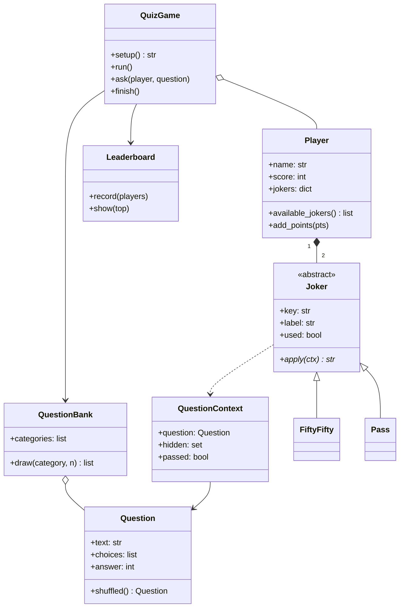

# Quiz chronométré multijoueur

> **Jeu n° 29 / 50** · Niveau ★★ Intermédiaire

|                                |                                                                                                       |
| ------------------------------ | ----------------------------------------------------------------------------------------------------- |
| **Établissement**       | École Supérieure de Technologie d'El Kelâa des Sraghna (ESTK) — Université Cadi Ayyad, Marrakech |
| **Parcours**             | Science des Données (SD) · Réseaux, Cloud et Cybersécurité (RCC)                                 |
| **Semestre**             | 1                                                                                                     |
| **Module**               | POO — Mini-projets : « 50 jeux avec interface graphique »                                          |
| **Encadrant**            | Pr. BERKA Anas — a.berka@uca.ac.ma                                                                   |
| **Année universitaire** | 2026-2027                                                                                             |
| **Réalisé par**        | LAKHIAL El Mehdi , BELATTAR Othmane , BOUTOUCHA Ismail                                                                                |

---

## 1. Principe

Quiz à choix multiples par catégories, avec **temps limité** par question, **jokers** et
**classement local persistant**. De 2 à 4 joueurs jouent à tour de rôle sur le même ordinateur.

Le projet est livré en **deux interfaces** qui partagent exactement les mêmes classes POO :

- **Console** (`quiz.py`) : jeu en terminal avec compte à rebours en direct.
- **Interface graphique** (`app.py`) : version web locale réalisée avec **Streamlit**.

## 2. Fonctionnalités attendues et réalisées

| Fonctionnalité demandée                               | Réalisation                                                                       |
| ------------------------------------------------------- | ---------------------------------------------------------------------------------- |
| QCM par catégorie, questions stockées dans un fichier | `questions.json` — 4 catégories (Java, Python, POO, C++), 12 questions chacune |
| Compte à rebours par question                          | Durée réglable (5 à 30 s) ; la question est perdue à 0 s                       |
| Jokers (50/50, passer)                                  | `FiftyFifty` et `Pass`, un seul usage de chaque par joueur et par partie       |
| 2 à 4 joueurs en local                                 | Les joueurs répondent chacun leur tour                                            |
| Classement persistant                                   | `leaderboard.json` (total des points, parties jouées, victoires)                |

## 3. Règles du jeu

- Chaque joueur reçoit le même nombre de questions (5 par défaut), posées à tour de rôle.
- Les quatre propositions sont **mélangées** à chaque question.
- **Bonne réponse** : `10` points + un **bonus de rapidité** allant jusqu'à `10` points
  (`bonus = 10 × temps restant / temps total`). Maximum : 20 points par question.
- **Mauvaise réponse**, **temps écoulé** ou **question passée** : 0 point, sans pénalité.
- **Joker 50/50** : retire deux mauvaises réponses (le chrono continue).
- **Joker Passer** : saute la question.
- À la fin, le classement de la partie s'affiche et les scores sont ajoutés au classement général.

## 4. Structure du projet

```
.
├── quiz.py            # Logique du jeu (classes POO) + version console
├── app.py             # Interface graphique Streamlit
├── questions.json     # Banque de questions par catégorie
├── leaderboard.json   # Classement persistant (créé automatiquement)
├── requirements.txt   # Dépendances (Streamlit)
├── .streamlit/
│   └── config.toml    # Thème clair de l'interface
└── README.md
```

## 5. Conception orientée objet

### Diagramme de classes



### Concepts de la POO mis en œuvre

| Concept                             | Où ?                                                                                                                          |
| ----------------------------------- | ------------------------------------------------------------------------------------------------------------------------------ |
| **Encapsulation**             | Chaque classe regroupe ses données et son comportement (`Player.add_points`, `Leaderboard.record`, `QuestionBank.draw`) |
| **Abstraction**               | `Joker` est une classe abstraite (`ABC`) avec la méthode abstraite `apply()`                                            |
| **Héritage**                 | `FiftyFifty` et `Pass` héritent de `Joker`                                                                              |
| **Polymorphisme**             | Le jeu appelle `joker.apply(ctx)` sans connaître le type exact du joker                                                     |
| **Composition / agrégation** | Un `Player` possède ses jokers ; `QuizGame` possède ses joueurs ; `QuestionBank` possède des `Question`             |
| **Responsabilité unique**    | Questions, joueurs, jokers, classement et déroulement du jeu sont séparés dans des classes distinctes                       |
| **Réutilisation**            | `app.py` importe les classes de `quiz.py` sans les réécrire                                                              |

## 6. Installation et exécution

**Prérequis** : Python 3.9 ou supérieur.

### Version console

```bash
python3 quiz.py
```

Réponses : `A`, `B`, `C`, `D` · `J` = joker 50/50 · `P` = passer.
Le compte à rebours en direct nécessite un vrai terminal (pas IDLE).

### Interface graphique (Streamlit)

```bash
pip install -r requirements.txt
streamlit run app.py
```

L'application s'ouvre dans le navigateur à l'adresse `http://localhost:8501`.

> Si le dossier caché `.streamlit/` est absent, lancer avec :
> `streamlit run app.py --theme.base light`

## 7. Ajouter ou modifier des questions

Les questions sont dans `questions.json`. Pour ajouter une catégorie ou une question :

```json
{
  "C++": [
    {
      "question": "Quel opérateur alloue dynamiquement un objet en C++ ?",
      "choices": ["alloc", "new", "make", "create"],
      "answer": 1
    }
  ]
}
```

- `choices` : exactement 4 propositions.
- `answer` : **index** (à partir de 0) de la bonne réponse dans `choices`.
- Une nouvelle catégorie apparaît automatiquement dans le menu du jeu.

## 8. Limites et améliorations possibles

- Les joueurs jouent à tour de rôle (pas de réponse simultanée).
- Le temps est vérifié côté application ; la barre de l'interface se rafraîchit chaque seconde.
- Pistes : sons, niveaux de difficulté, pénalité pour mauvaise réponse, export du classement.

## 9. Captures d'écran

_À compléter avec une capture de l'écran de configuration, d'une question et des résultats._
